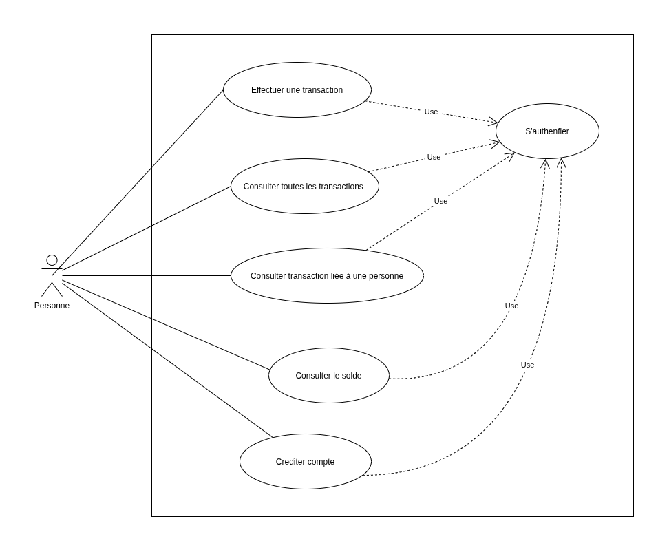
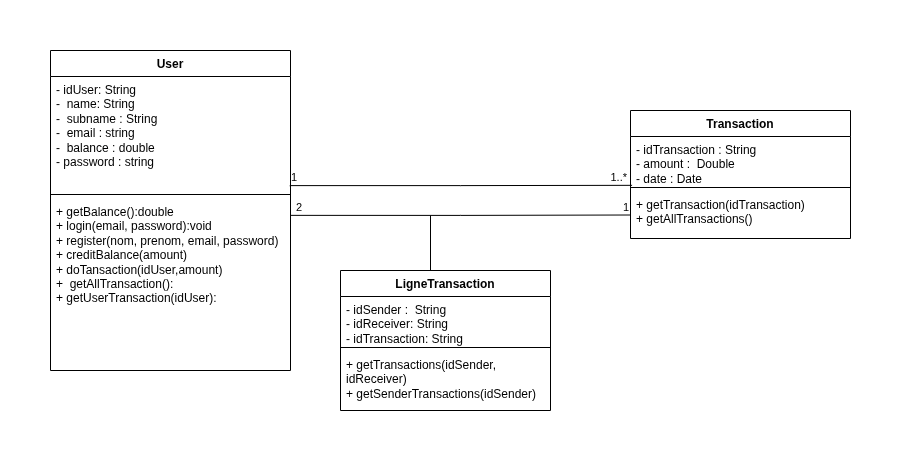

# TCHAI-THIERRY-NGOUPAYE-ESTELLE-NGAH
Projet Sécurité et Intégrité Cryptographique des données

## Auteurs

- Thierry NGOUPAYE DJIO - thierryngoupaye0@gmail.com
- Estelle NGAH NDONGO - estellendongo02@gmail.com

## Langage de programmation

- Backend : Python, Flask.
Nous avons choisi python pour sa simplicité.
- Frontend:
- Stockage: SQL Lite
Nous avons choisi ``SQL Lite`` car il est léger et c'est notre modélisation inclut des relations entre les tables.

## Tchai V1

La modélisation de la version 1 du système inclut un diagramme de cas d'utilisation et un diagramme de classes métier que vous pouvez retrouver ci-dessous.

### 1. Diagramme de cas d'utilisation

### 2. Diagramme de classes
